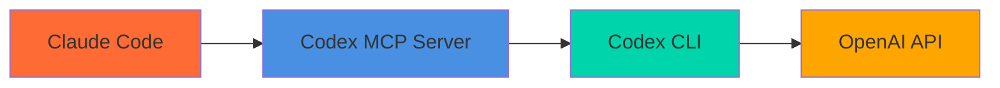

# Codex MCP Server

[](https://www.npmjs.com/package/codex-mcp-server)
[](https://www.npmjs.com/package/codex-mcp-server)
[](https://www.npmjs.com/package/codex-mcp-server)

Bridge between Claude and OpenAI's Codex CLI — get AI-powered code analysis, generation, and review right in your editor.



## Quick Start

### 1. Install Codex CLI

```bash
npm i -g @openai/codex
codex login --api-key "your-openai-api-key"
```

### 2. Add to Claude Code

```bash
claude mcp add codex-cli -- npx -y codex-mcp-server
```

### 3. Start Using

```
Ask codex to explain this function
Use codex to refactor this code for better performance
Use review to check my uncommitted changes
```

## One-Click Install

[](https://vscode.dev/redirect/mcp/install?name=codex-cli&config=%7B%22type%22%3A%22stdio%22%2C%22command%22%3A%22npx%22%2C%22args%22%3A%5B%22-y%22%2C%22codex-mcp-server%22%5D%7D)
[](https://insiders.vscode.dev/redirect/mcp/install?name=codex-cli&config=%7B%22type%22%3A%22stdio%22%2C%22command%22%3A%22npx%22%2C%22args%22%3A%5B%22-y%22%2C%22codex-mcp-server%22%5D%7D)
[](https://cursor.com/en/install-mcp?name=codex&config=eyJ0eXBlIjoic3RkaW8iLCJjb21tYW5kIjoibnB4IC15IGNvZGV4LW1jcC1zZXJ2ZXIiLCJlbnYiOnt9fQ%3D%3D)

## Tools

| Tool | Description |
|------|-------------|
| `codex` | AI coding assistant with session support, model selection, and structured output metadata |
| `review` | AI-powered code review for uncommitted changes, branches, or commits |
| `websearch` | Web search using Codex CLI with customizable result count and search depth |
| `listSessions` | View active conversation sessions |
| `ping` | Test server connection |
| `help` | Get Codex CLI help |

## Examples

**Code analysis:**
```
Use codex to analyze this authentication logic for security issues
```

**Multi-turn conversations:**
```
Use codex with sessionId "refactor" to analyze this module
Use codex with sessionId "refactor" to implement your suggestions
```
Passing a sessionId creates the session on first use, so listSessions will show
it (for this server instance) and subsequent calls can resume context.

**Code review:**
```
Use review with base "main" to check my PR changes
Use review with uncommitted true to review my local changes
```

**Advanced options:**
```
Use codex with model "o3" and reasoningEffort "high" for complex analysis
Use codex with fullAuto true and sandbox "workspace-write" for automated tasks
Use codex with callbackUri "http://localhost:1234/callback" for static callbacks
Use codex to return structuredContent with threadId metadata when available
```

**Web search:**
```
Use websearch with query "TypeScript 5.8 new features"
Use websearch with query "Rust vs Go performance 2025" and numResults 15
Use websearch with query "React Server Components" and searchDepth "full"
```

## Requirements

- **Codex CLI v0.75.0+** — Install with `npm i -g @openai/codex` or `brew install codex`
- **OpenAI API key** — Run `codex login --api-key "your-key"` to authenticate

## Codex 0.87 Compatibility
- **Thread ID + structured output**: When Codex CLI emits `threadId`, this server returns it in content metadata and `structuredContent`, and advertises an `outputSchema` for structured responses.

## Documentation

- **[API Reference](docs/api-reference.md)** — Full tool parameters and response formats
- **[Session Management](docs/session-management.md)** — How conversations work
- **[Codex CLI Integration](docs/codex-cli-integration.md)** — Version compatibility and CLI details

## Environment Variables
- `CODEX_MCP_CALLBACK_URI`: Static MCP callback URI passed to Codex when set (overridden by `callbackUri` tool arg)

## Development

```bash
npm install    # Install dependencies
npm run dev    # Development mode
npm run build  # Build for production
npm test       # Run tests
```

## Related Projects

- **[gemini-mcp-server](https://github.com/tuannvm/gemini-mcp-server)** — MCP server for Gemini CLI with 1M+ token context, web search, and media analysis
- **[Clotch](https://github.com/tuannvm/clotch)** — Dynamic Island for Claude Code on macOS — monitor sessions across multiple machines and providers in real time

## License

ISC

## Local checkout: Claude Code and Qwen Code

Install dependencies with `npm ci`, then register the source launcher in either
client's user-level `mcpServers` configuration. It runs the checkout directly with
`tsx`, so local updates do not depend on stale files under `dist/`.

```json
{
  "mcpServers": {
    "codex-mcp": {
      "command": "node",
      "args": ["/absolute/path/to/codex-mcp-server/scripts/start-local.mjs"],
      "env": { "CODEX_DEFAULT_MODEL": "gpt-6-astra" }
    }
  }
}
```

Claude Code uses its user `.claude.json`; Qwen Code uses `~/.qwen/settings.json`.
Reconnect the MCP server or restart the client after changing the configuration.
Both clients get `codex`, `review`, `websearch`, `listSessions`, `ping`, and `help`.
The existing model override remains supported; model availability and reasoning
levels depend on the signed-in Codex account.

Current CLI compatibility includes `max`/`ultra` reasoning (where supported),
image attachments (`images`), live search (`search`), named configuration profiles
(`profile`), response schemas (`outputSchema`), and temporary sessions
(`ephemeral`, incompatible with `sessionId`). `review` also accepts
`reasoningEffort`. Review targets (`uncommitted`, `base`, `commit`) are mutually
exclusive and cannot be combined with a custom review prompt. For the latest
commit, use `commit: "HEAD"`.

Use `help` with `command: "version"` to inspect the installed Codex CLI revision,
or `exec`, `resume`, or `review` for current command help. Update the CLI with
`codex update`; update this checkout deliberately after reviewing upstream changes.
`fullAuto` remains accepted and uses supported sandbox/approval configuration
instead of the removed `--full-auto` flag. Existing resume behavior still omits
sandbox, auto mode, and working-directory overrides.
